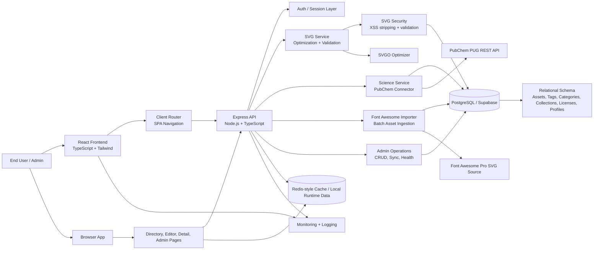

# Architecture Overview

This project is a full-stack SVG library and studio. The architecture combines a React frontend, an Express API layer, relational storage, SVG optimization and sanitization services, and optional integrations for asset import and chemical metadata lookup.

## Core Components

- Frontend: React 19 single-page application with pages for directory browsing, code editing, asset details, and admin workflows.
- API Layer: Express server exposing REST endpoints for asset listing, detail retrieval, optimization, import, and admin operations.
- Database: Relational storage for SVG assets, collections, categories, licenses, tags, and user profiles.
- SVG Engine: SVGO and custom sanitization for safe optimization, minification, and stored-XSS prevention.
- Science Integration: Connects to PubChem for molecular metadata and vector rendering workflows.
- Import Pipeline: Imports local Font Awesome Pro SVG assets into the database without altering source files.
- Security Layer: Runtime validation and filtering of dangerous SVG payloads and URI schemes.

## Data Flow

1. Users interact with the React app.
2. The UI calls the Express API for listing, searching, editing, and admin tasks.
3. The API validates requests and delegates work to SVG, admin, or science services.
4. Data is stored in PostgreSQL/Supabase with relational associations such as tags, collections, and categories.
5. Optimized, validated SVG content is served back to the frontend for preview, export, and editing.

## Key Architectural Characteristics

- Full-stack TypeScript-based development
- Security-first SVG handling
- Relational data model for metadata and taxonomy
- Server-side optimization and validation
- Modular services for import, admin operations, and scientific integrations
- Browser-based asset studio with a responsive UX

## Repository Structure Summary

- `src/components/`: UI pages and dashboard views
- `src/server/`: API, optimization, science, and sanitization services
- `src/db/`: Database schema and migration logic
- `src/utils/`: Export, routing, and optimization helpers
- `server.ts`: Application entry point
- `.data/`: Local database storage
